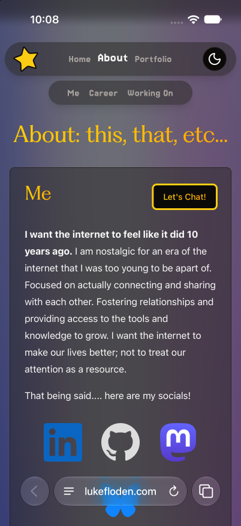
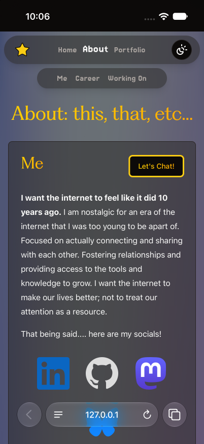
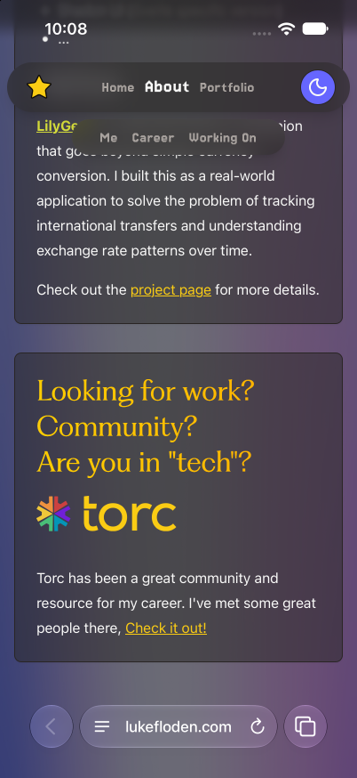
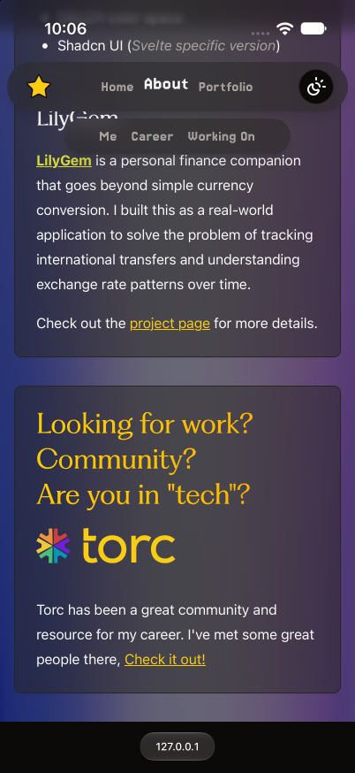
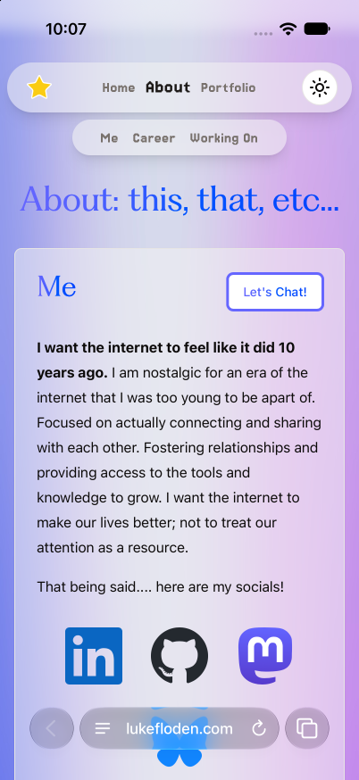
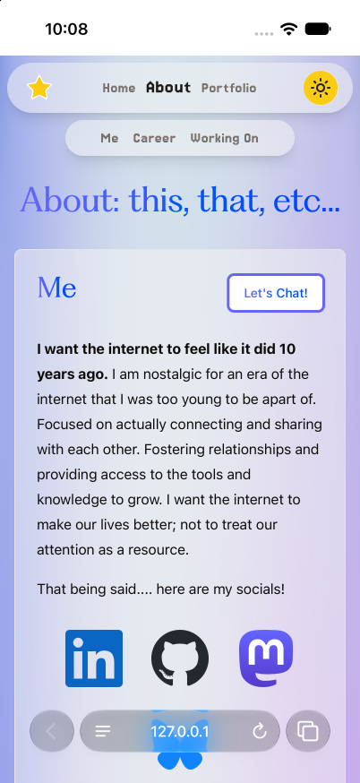
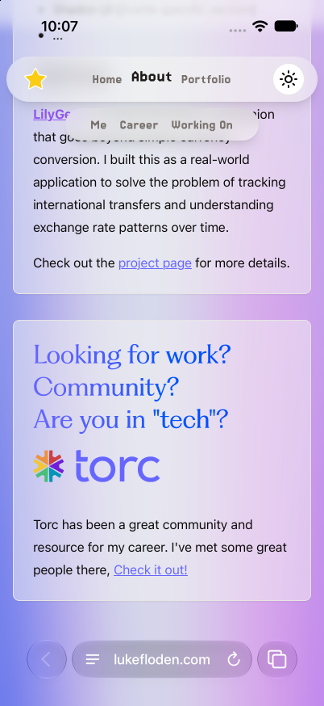
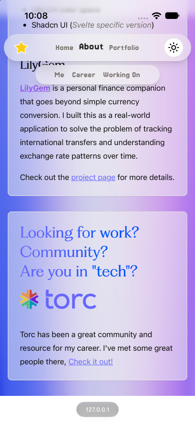

# Safari document scrolling: incomplete candidate

The native controls work on About, but the image does not continue behind Safari at both document edges.
This candidate must not merge as the fix for [issue #37](https://github.com/bionboy/lukefloden.com/issues/37).

## Cause and candidate

The baseline uses an inner scroller inside a parked document of `300lvh`.
`PageViewport.svelte` routes the site's scroll operations to that inner scroller on iOS.
The inline script in `app.html` parks the document before hydration.
This explains why the site's star works while Safari's native controls do not.

The candidate removes that layout and uses document scrolling through the existing shared scroll interface.
It retains the body image and dark overlay from PR #36.
It removes the nested layout rules from the headers and hero.
SvelteKit owns document scroll restoration and fragment navigation again.
Those navigation paths still need acceptance tests.

No scroll clamp, artificial bleed spacer, timing loop, or sampled background color remains in this candidate.
The saved clamp experiment was not a complete fix and is not included.

## Test environment

- Captured on 2026-10-29, on lilac.
- iPhone 17 Pro simulator, iOS 27.0 runtime, native Safari supplied with that runtime.
- Portrait, 402 × 874 points; PNGs use one pixel per point.
- Candidate: local production build at `https://127.0.0.1:4173/about`, using the source in this commit.
- Baseline: production at `https://www.lukefloden.com/about`, after PR #36, captured during this session.
- Baseline source history: PR #36 merged as `69bbc5df22eda4a93422f0a51174181f7604dafa`.
  The production URL identifies the captured deployment; its exact deployed commit was not independently established.
- Themes were selected with the site's theme button and checked in the captured images.

## Results

| Check                               | Result                                                                                      |
| ----------------------------------- | ------------------------------------------------------------------------------------------- |
| Native status-bar tap on About      | Reaches the top. The first tap expands collapsed controls; the next tap scrolls to the top. |
| Toolbar collapse on downward scroll | Works on About. The recording shows expanded controls change to the small address capsule.  |
| Image at the document start         | Fails. A solid black or white area appears behind the status bar.                           |
| Image at the document end           | Fails. A solid area appears behind the bottom control.                                      |
| Image during middle scrolling       | Image and content remain visible behind the controls in the inspected dark-mode frames.     |
| Build                               | Passes: `aubr build`.                                                                       |
| Svelte and types                    | Passes: `aubr check`, zero errors and warnings.                                             |
| Lint                                | Passes: `aubr lint`.                                                                        |
| Changed-source formatting           | Passes: Prettier on the four changed source files.                                          |
| Whitespace                          | Passes: `git diff --check`.                                                                 |

The [recording](simple-native-controls.mp4) shows the native taps and subsequent downward scroll in dark mode.
I decoded the recording and inspected [frames during movement](native-controls-frames.jpg), including the return to the top and toolbar collapse.
The compressed recording retains all 28 seconds at 15 frames per second.

## Matched comparisons

Each pair uses the same device, native browser, portrait viewport, theme, route, and content boundary.
At the end, the candidate's toolbar is collapsed and the baseline's toolbar stays expanded.
This difference is the behavior under test.
The bottom screenshots show each layout's reachable end, rather than equal numerical scroll offsets.

| State        | Production after PR #36                               | Candidate                                            |
| ------------ | ----------------------------------------------------- | ---------------------------------------------------- |
| Dark, start  |    |    |
| Dark, end    |      |      |
| Light, start |  |  |
| Light, end   |    |    |

## Independent native validation

Claude Opus 5.5 [reproduced the native controls and both image failures](native-inset-audit/README.md) on the actual production build.
The report includes new recordings, fixture tests, source corrections, and explicit coverage limits.
No tested fix meets all requirements.

## Further investigation

The [native boundary tests from October 30](native-boundary-probe/README.md) cover additional CSS layouts, scroll snapping, and root scroll bounds.
No tested alternative meets all requirements. The application code remains unchanged.

## Open work

First find a layout that keeps the image behind both native controls at the document boundaries.
The simple document layout tested here does not meet that requirement.
This result does not prove that every simpler layout must fail.

After that blocker is resolved, complete the acceptance matrix from #37:

- Home, About, Portfolio, and affected child routes in both themes.
- Startup, both edges, overscroll, and route transitions, with recordings inspected during movement.
- Me, Career, Working On, fragments, Back restoration, the star, headers, and parallax.
- Rotation, desktop behavior, printing, and the page without JavaScript.
- A real iPhone pass, with its OS and browser recorded.
- An iOS 26 pass before claiming iOS 26 compatibility.

These items are not covered by the About evidence here.
